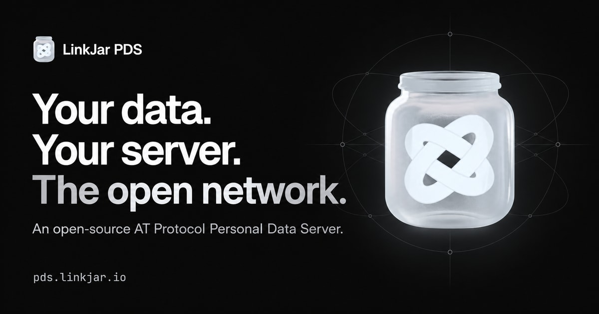

[](https://pds.linkjar.io/)

# LinkJar PDS

Host your accounts, records, and media on the open network. LinkJar PDS is an
[AT Protocol](https://atproto.com/) Personal Data Server written in Rust.
It runs as one executable and uses the reference server's data layout and
configuration names.

[Documentation](https://pds.linkjar.io/) ·
[Builds and downloads](https://pds.linkjar.io/start/builds/) ·
[Native installation](https://pds.linkjar.io/start/native/) ·
[Docker installation](https://pds.linkjar.io/start/install/)

[](https://github.com/linkjar/pds/actions/workflows/rust.yml)
[](https://github.com/linkjar/pds/actions/workflows/nix.yml)
[](https://github.com/linkjar/pds/actions/workflows/site.yml)

## Run it your way

Start with one host, SQLite repositories, and media on disk. Add an S3-compatible
blob store or Postgres for shared state when your operation needs them.
Docker is optional.

| Install with | What you get | Guide |
|---|---|---|
| **Linux binary** | A portable static executable for AMD64 or ARM64; no Nix or Docker on the host | [Download and verify](https://pds.linkjar.io/start/builds/#download-a-portable-linux-build) |
| **Nix or NixOS** | A locked build, development shell, and NixOS service with a dedicated user and private state | [Install natively](https://pds.linkjar.io/start/native/#nixos-service) |
| **Cargo** | A release executable built for your host | [Build from source](https://pds.linkjar.io/start/builds/#build-with-cargo) |
| **Docker Compose** | A pinned container image behind Caddy, with persistent data on the host | [Install with Docker](https://pds.linkjar.io/start/install/) |

From a checkout at the source commit you reviewed, build just the server:

```sh
nix build .#linkjar-pds
result/bin/linkjar-pds version
```

Or use the Rust toolchain selected by `rust-toolchain.toml`:

```sh
cargo build --release --locked --package linkjar-pds --bin linkjar-pds
target/release/linkjar-pds version
```

The normal Nix package supports Linux on `x86_64` and `aarch64`, and Apple Silicon
macOS. It needs its Nix store closure. The portable static build is Linux-only;
see [the build guide](https://pds.linkjar.io/start/builds/) for checksums, supported
architectures, runtime requirements, and the 14-day retention of CI artifacts.

Before serving accounts, configure the domain, secrets, storage, CA certificates,
and public HTTPS. The [native guide](https://pds.linkjar.io/start/native/) includes
NixOS and plain Linux systemd services, a Caddy configuration, and a Docker
cutover procedure. Native HTTP uses port `2583`; keep it private behind the proxy.
The executable reads its environment and does not load `.env` files itself.

## What the server does

| Area | Included |
|---|---|
| Accounts and identity | Account lifecycle, handles, PLC operations, sessions, app passwords, and OAuth |
| Repositories and media | Signed repositories, records, CAR imports and exports, local or S3-compatible blobs |
| Network | XRPC APIs, AppView proxying, and the repository firehose |
| Operations | Configuration checks, data verification, audit bundles, JSON logs, health, and Prometheus metrics |
| Deployment | One server, or an entryway and one member host; SQLite or Postgres for the shared tier |
| Optional sidecars | An operations console and an MCP server for AI clients; separate from the native PDS package |

The `stock` profile follows the reference server's behavior. The `linkjar` profile
adds LinkJar's external sign-in providers, handle policy, account creation receipt,
and mail. Both share the repository engine, storage, and firehose.
[Profiles](https://pds.linkjar.io/configure/profiles/) explains the choice.

### Architecture

Clients reach the PDS through a TLS proxy. The PDS keeps account data and
repositories, resolves identities, and connects to the AppView and relays.
Optional sidecars use its APIs without holding the server's signing keys.

<details>
<summary>View the system diagram</summary>

<picture>
  <source media="(prefers-color-scheme: dark)" srcset="docs/architecture/svg/02-system-context.dark.svg">
  
</picture>

</details>

The diagram is the same maintained source used by the
[architecture guide](https://pds.linkjar.io/reference/architecture/).
[The crate map](docs/crates.md) explains the code behind each part.

## Compatibility and status

The compatibility baseline is **`@atproto/pds@0.5.34`**, pinned in
[`upstream.json`](upstream.json). The parity harness compares behavior against
that reference; this is not a claim of parity with every later upstream release.
[Recorded differences](parity/differences/README.md) and
[the specification](docs/SPEC.md) describe the intended behavior.

LinkJar's invite-only pilot moved from the reference image to this server on
2026-10-15, keeping the existing data directory. The
[cutover record](docs/research/2026-10-15-pilot-cutover.md) documents that change.
[The plan](docs/plan.md) tracks completed work, open items, and operator steps.

## Operate it

| Task | Guide |
|---|---|
| Check a new installation | [HTTPS, metadata, health, and smoke tests](https://pds.linkjar.io/start/verify/) |
| Configure recovery email | [SMTP configuration and testing](https://pds.linkjar.io/configure/email/) |
| Protect and recover data | [Backups and restore](https://pds.linkjar.io/operate/backup/) |
| Update a build | [Native, NixOS, and Docker updates; rollback limits](https://pds.linkjar.io/operate/update/) |
| Inspect a running server | [Logs, health, and private metrics](https://pds.linkjar.io/operate/monitoring/) |
| Verify or export data | [Operator commands and service configuration](https://pds.linkjar.io/operate/cli/) |

Keep the full account database, including credential recovery state, and every
secret in your backups. An older server can read the storage layout while
applying different authentication rules. Review the
[rollback guidance](https://pds.linkjar.io/operate/update/#roll-back) before switching builds.

For an AI assistant, use the docs site's **Copy page** action,
[documentation index](https://pds.linkjar.io/llms.txt), or
[complete Markdown guide](https://pds.linkjar.io/llms-full.txt).

## Develop and check

Use `nix develop` for the workspace toolchain and build tools, or the existing
`devenv shell`. The server alone builds without Node or Docker. Workspace tests
also exercise the console and MCP client; see [the crate map](docs/crates.md)
for their Tailwind, Node, and other requirements. The simulation needs libclang.

```sh
cargo fmt --all -- --check
cargo clippy --workspace --all-targets --all-features --locked -- -D warnings
cargo test --workspace --locked
cargo xtask codegen --check
cargo deny check
cargo vet --locked
```

Run the simulation or the native packaging checks (the smoke script needs Python 3):

```sh
cargo run -p pds-sim -- --seeds 20
cargo run -p pds-sim -- --network
nix flake check --all-systems --no-build
python3 nix/tests/native-smoke.py result/bin/linkjar-pds
```

The native smoke test uses disposable data. Test migrations and restores on a
copy of production data with a private configuration. Creating an account with
a real PLC directory writes a DID there, even if you later delete the account.

The [parity harness](parity/README.md) needs Docker and runs separately:

```sh
cd parity
pnpm install --frozen-lockfile
pnpm parity run reference
pnpm parity compare reference repeat
pnpm parity images build-candidate
pnpm parity restore
pnpm parity writes
pnpm parity smoke https://pds.example.com
```

The [documentation site](site/README.md) also builds separately:

```sh
cd site
pnpm install --frozen-lockfile
pnpm dev
```

CI runs Rust and supply-chain checks, native package and service tests, and
documentation checks. Native and documentation workflows save build artifacts;
they do not deploy. The documentation is hosted on Cloudflare Workers at
[pds.linkjar.io](https://pds.linkjar.io/). GitHub Pages is disabled.

`devenv shell -- pds:check` runs the Rust gates. `devenv shell -- pds:hooks` runs
the formatting and lint hooks manually. No Git hook is installed automatically;
linked worktrees share their hooks directory.

## Measurements

The published measurements compare specific workloads on one Apple M1 Pro
under Docker. They are historical observations, not a throughput guarantee or
a comparison of the new native build types.

| Workload | Reference | Rust server | Source |
|---|---|---|---|
| Export 100,000 records, median of five runs | 1,385 ms | 167 ms | [Reads](parity/results/perf-reads.md) |
| Memory before the first read | 280.4 MiB | 5.4 MiB | [Reads](parity/results/perf-reads.md) |
| Create one record with 1,000 existing records, p50 | 14.4 ms | 4.9 ms | [Writes](parity/results/perf-writes.md) |
| Create a batch of 200 with 1,000 existing records, p50 | 190.3 ms | 14.3 ms | [Writes](parity/results/perf-writes.md) |
| Create one record with 100,000 existing records, p50 | 14.5 ms | 11.5 ms | [Writes](parity/results/perf-writes.md) |

Read requests in those measurements are sequential. The
[reference baseline](parity/results/perf-reference.md) covers additional workloads,
and [the repository benchmarks](bench/README.md) compare the repository engine
with `rsky-repo`, including the method and fixtures.

## Documentation and source

Start with [the hosting guide](https://pds.linkjar.io/start/overview/).
The [engineering documentation](docs/README.md) maps the specification,
architecture, runbooks, research, and implementation records.

| Path | Contents |
|---|---|
| `crates/` | The workspace crates, one per subsystem, each with a README ([map](docs/crates.md)) |
| `crates/linkjar-pds/` | The binary: `serve`, `verify`, `export-car`, `audit`, `migrate-storage`, `reconcile`, `check-config`, `health`, `version` |
| `crates/pds-sim/` | The simulation: `pds-sim --seeds N` runs seeded plans against the server in process |
| `Dockerfile`, `Dockerfile.console`, `Dockerfile.mcp` | The images of the server and its two sidecars |
| `deploy/compose/` | The Compose deployment of one host: the server behind Caddy |
| `flake.nix`, `nix/` | Native packages, a development shell, the NixOS service, and packaging tests |
| `site/` | The self-hosting guide, [pds.linkjar.io](https://pds.linkjar.io) |
| `xtask/` | Repository tasks: `cargo xtask codegen` generates API types from the lexicons |
| `lexicons/` | Vendored upstream lexicons at the pin, LinkJar lexicons, project lexicons ([notice](lexicons/NOTICE.md)) |
| `interop/` | CC0 interop test vectors from upstream ([notice](interop/README.md)) |
| `fuzz/` | cargo-fuzz targets for every parser of untrusted bytes |
| `parity/` | The parity harness: the compose stack, scenarios and oracles that hold a target to the reference image ([README](parity/README.md)) |
| `bench/` | The repository engine beside `rsky-repo` on the same vectors and workload ([README](bench/README.md)) |
| `docs/` | Specification, plan, architecture, runbooks, research ([map](docs/README.md)) |
| `.agent_sources/` | Checkouts of the pinned upstream sources for reading: `scripts/vendor-agent-sources.sh` |
| `scripts/` | `vendor-agent-sources.sh` fetches the upstream checkouts; `check-upstream.py` reports upstream releases newer than the pin |
| `upstream.json` | The reference pin: the upstream tag, commit and official distribution digest that the lexicons, the mail templates and the parity harness read |


## Contributing

A behavior change starts with [the specification](docs/SPEC.md). Update its tests,
architecture diagrams, and user documentation in the same change. Follow
[the plan](docs/plan.md#units) for the work units and their required checks.
Use [GitHub issues](https://github.com/linkjar/pds/issues) for bugs and proposals.

## License

Dual-licensed under [MIT](LICENSE-MIT) or [Apache-2.0](LICENSE-APACHE).
[Upstream notices](docs/licenses/) cover the vendored material.
