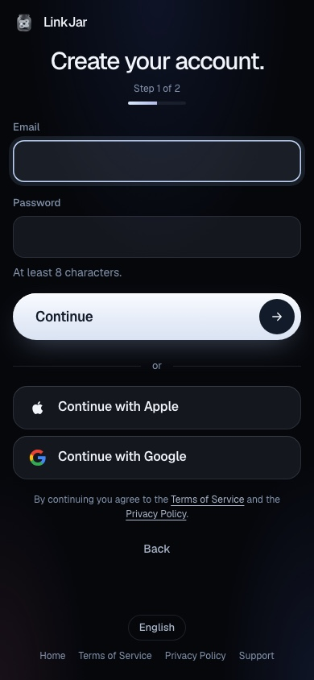
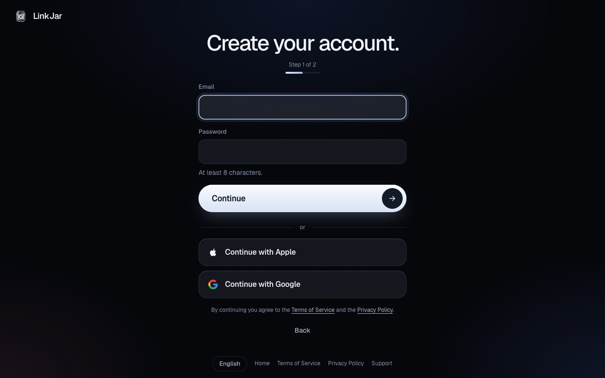
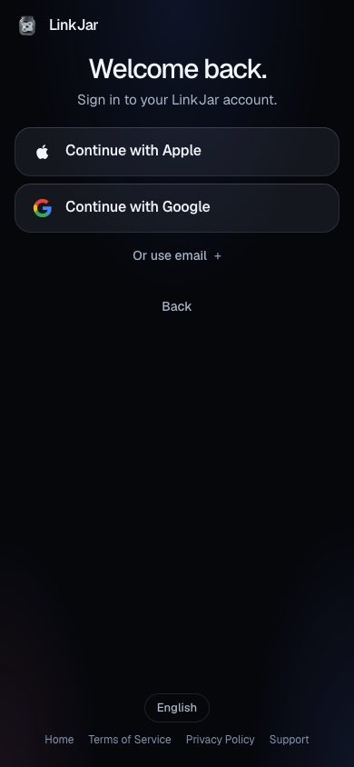
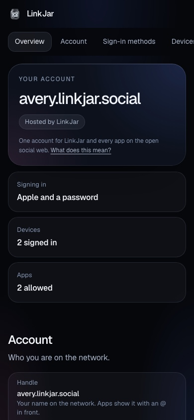
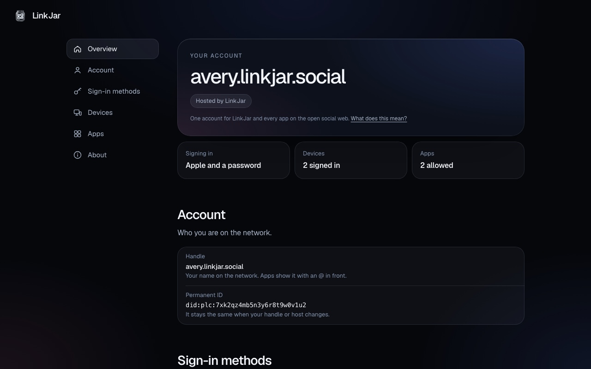
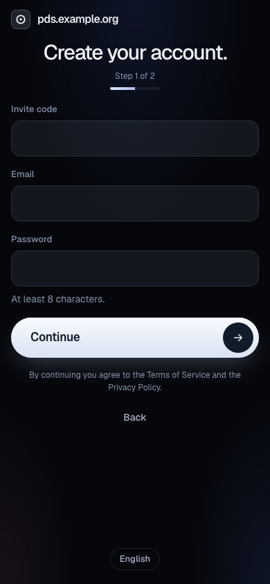
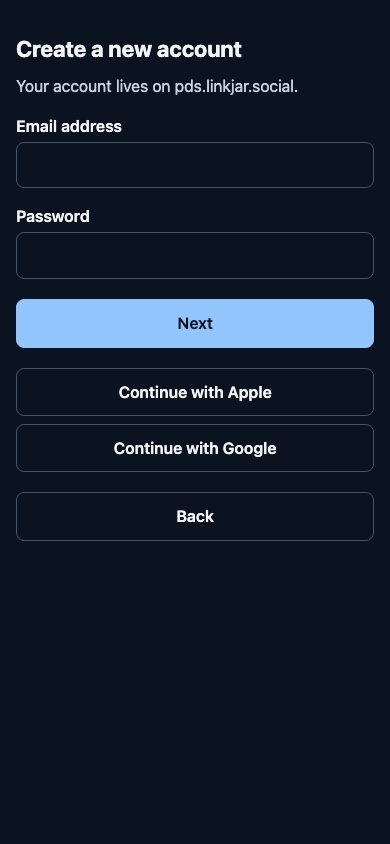
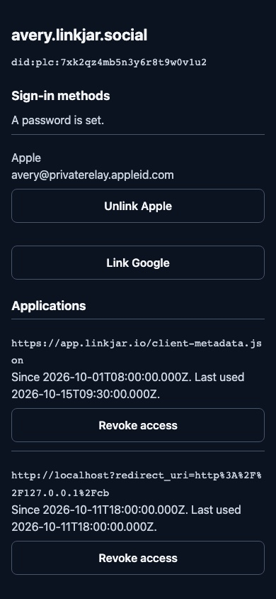

# The pages

The server renders its own sign-in, sign-up, consent, account and error
pages (`crates/pds-oauth/src/pages.rs`). Since 2026-10-15 they wear the
LinkJar journey: the look of the app's onboarding, as the patched Reference
build had it (patch 102, the sign-up journey, whose document left with the legacy tree on 2026-10-15)
and as the app repository's prototype draws it
(`apps/web/src/styles/prototype/social.css` and
`apps/web/src/pages/prototype/account.astro` in `linkjar.io`).

`crates/pds-oauth/src/theme.rs` holds the design tokens in one block, the
rules, and the typeface and the marks, which the server serves under
`/oauth/assets/`. The console redesign takes the same tokens.

| | Phone, 390 px | Desktop, 1280 px |
|---|---|---|
| Sign-up, step 1 |  |  |
| Sign-in |  | |
| Account page |  |  |
| Sign-up under the `stock` profile, invite required |  | |

Before, the pages had a generic style:

| Sign-up | Account page |
|---|---|
|  |  |

The page functions are pure. To look at them again, write each one's
output to a file from a test and open the files next to a copy of
`crates/pds-oauth/assets/` under `oauth/assets/`.
