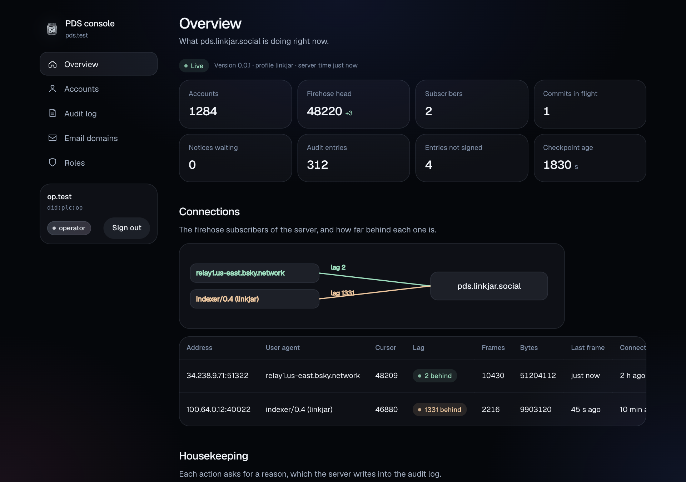
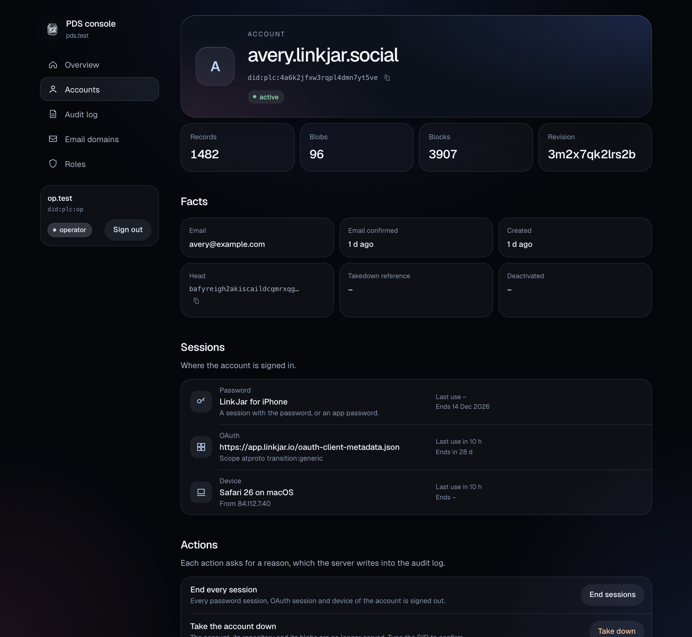
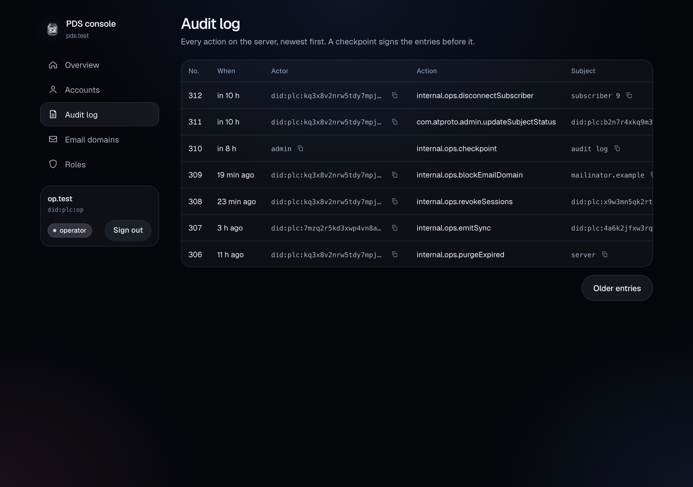
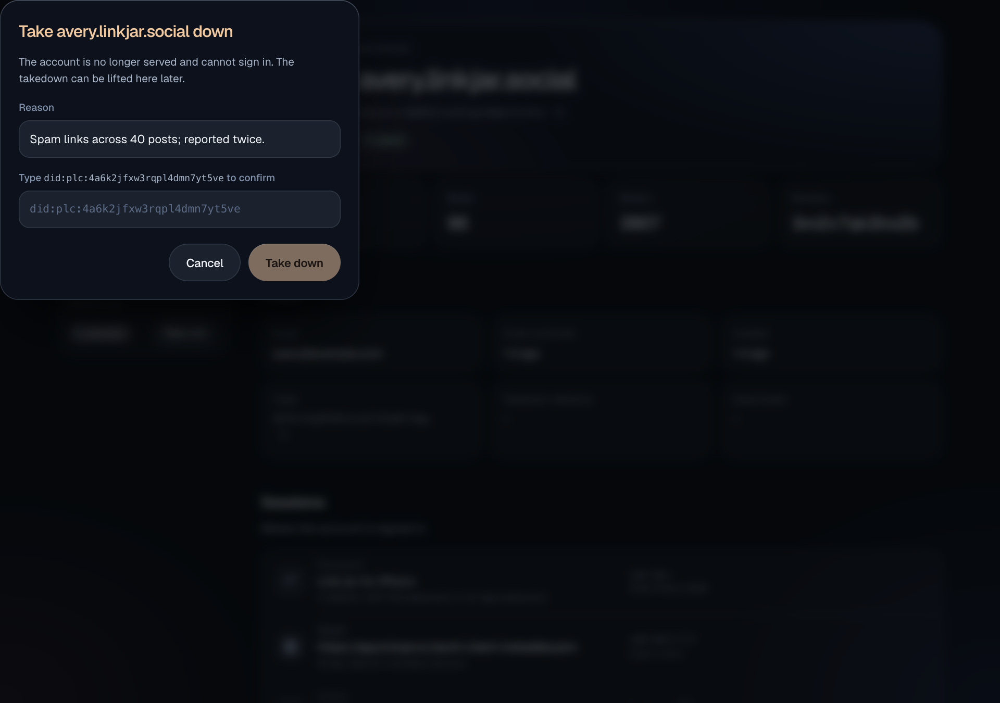
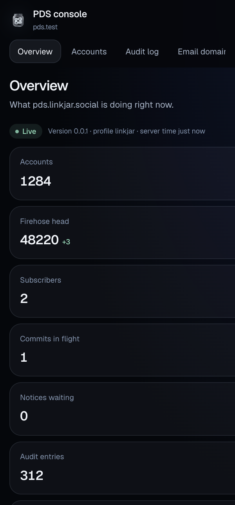
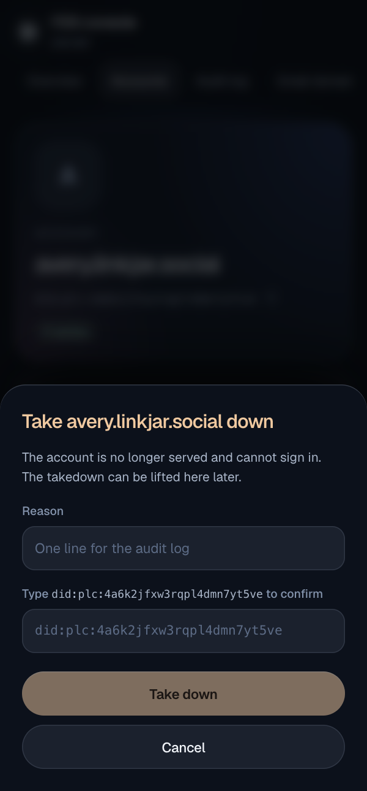

# The console on Topcoat: the LinkJar look, the live view and the search

Date: 2026-10-16 · [Unit 9 record](2026-10-13-ops-console.md) · [SPEC §22.1](../SPEC.md#221-ops-listener) · [sidecars.md §1.6](../sidecars.md#16-state-after-unit-9)

The console of unit 9 was two thousand lines of axum with six pages of
hand-written HTML, a thirty-line stylesheet and a script that asked for
`/live.json` every two seconds. The owner found it ugly, and on
2026-10-15 chose to rewrite it on Topcoat 0.10 with the look of LinkJar.
This record says what was built, how, and what differs from the plan.

## 1. Result

| Part | State |
|---|---|
| Topcoat 0.10 | The pages, the router, the asset bundle and the browser runtime; the features `router`, `view`, `runtime`, `asset`, `serve` and `tailwind`, no default. |
| The look | The tokens of the LinkJar journey are the one block of `pds_oauth::theme`, which the pages of the PDS use too; the console serves it at `/theme.css` with the typeface and the mark under the same paths as the PDS. `src/theme.css` builds the components on those tokens: the dark stage with its three blooms, Geist, the ink scale, hairlines, fills, the accent, the light pill. |
| Components | Hand-written in `src/ui.rs` after the anatomy of Base UI: stat tile, chip, monospace identifier with a copy button, relative time, data table, grouped rows, empty state, alert, toast, trigger and dialog, the topology. Each part is an element with a `data-slot`; a state is a data attribute. |
| Layout | A sidebar with the mark, the server, the five sections and the operator with the sign-out; a content column with a title and a toolbar. On a phone the sidebar is a bar at the top. |
| Pages and actions | The six pages and nine actions of unit 9. Every action opens a dialog with the reason; the takedown asks for the DID typed again. |
| Account search | On the accounts page. An address goes to `com.atproto.admin.searchAccounts` on the ops listener; a handle or a DID is found in the listing. |
| Live view | The overview reads `internal.ops.subscribeState` with the operator's session and emits each frame to the browser over Topcoat's runtime socket. No polling, no reload. |
| Posture | No database, no key, no secret of the PDS; the token of the session and the origin check on every form; a content security policy of `default-src 'none'` with `'unsafe-eval'` for Topcoat's runtime. |
| Supply chain | 74 crates more in the lockfile, all with a `safe-to-deploy` exemption; one licence exception for `webpki-roots`. |
| Image | `Dockerfile.console` builds on both architectures: the Tailwind CLI is downloaded inside `cargo build`, pinned by release and hash, and the executable bundles its own assets. |

## 1.1 The look

Taken from headless Chrome against the stand-in of the tests with sample
values (`cargo test -p pds-console --lib tests::demo -- --ignored`), at
1280 and 400 pixels.

| | |
|---|---|
|  |  |
|  |  |
|  |  |

## 2. How it is built

- **Routes.** Explicit paths on Topcoat's router, no module routing:
  `#[page]` for the six pages and the sign-in page, `#[route]` for the
  sign-in start, the OAuth callback, the sign-out, the action and the
  health check. A pathless layer adds the security headers to every
  response, and `BodyLimit` keeps the 16 KiB limit of a form. The runtime
  layer comes last, so the page reruns reach the layers as a `GET`.
- **Sessions and the client stay.** `session.rs` gained the handle of the
  operator, which the callback reads from the account card for the
  sidebar. `client.rs` gained one method: the WebSocket handshake of the
  stream, with the same DPoP proof and the same nonce retry as a call.
- **Pages as components.** Each page is a `#[component]` that renders the
  whole document; the handler calls it inside a `view!` with a `match` on
  the outcome of the call to the listener, so a refusal renders the
  failure page with its status. Every value of the PDS is escaped by
  Topcoat: `<`, `>` and `&` in text, `"` and `&` in an attribute.
- **The live view.** The overview page starts a `Feed` when the render is
  a connected one: one task reads the stream of the ops listener and
  publishes each frame on a `watch` channel; the task is aborted when the
  page's regions are dropped. The page has two live regions. The numbers,
  the diagram and the subscriber table emit on every frame, with the
  change of each tile since the frame before. The disconnect dialogs emit
  only when a subscriber comes or goes, so an open dialog is not replaced
  under the operator. The HTTP render emits once and asks the browser to
  connect; Topcoat morphs the regions in place.
- **Dialogs without a script of our own.** A trigger opens its dialog
  with the `command` and `commandfor` attributes of HTML (Chrome 135,
  Safari 26, Firefox 144), and the dialog closes the same way or with
  Escape. The typed DID is a `pattern` on the field, escaped for the `v`
  flag, and the server checks it again.
- **One definition of the look.** PR #67 put the tokens of the journey
  into `pds_oauth::theme` for the pages of the PDS: `TOKENS`, a `:root`
  block of `--lj-*` custom properties, `FONT_FACE`, and `asset()` with
  the typeface and the marks. The console depends on `pds-oauth` already,
  so it serves `TOKENS` and `FONT_FACE` at `/theme.css` and the files of
  `asset()` under `/oauth/assets/`, the paths of the PDS, kept for a year
  as there. The Tailwind input references `var(--lj-ink)` and the other
  tokens and defines none of its own but the radii; a change of colour
  in `theme.rs` is a change of colour in both. The rules of the PDS
  pages (`RULES`) stay with that markup: the console's components have
  their own anatomy.
- **Assets.** The stylesheet and Topcoat's runtime script are Topcoat
  assets with content-hashed names. The image carries the bundle next to
  the executable, written in the build stage by
  `linkjar-pds-console bundle-assets`. A development build or a test has
  no bundle, so the executable reads its own asset declarations and
  copies the files into the temporary directory; this needs the sources
  of the build on the machine, which a test runner has.
- **Tailwind.** `build.rs` runs the standalone CLI 4.3.2 over
  `src/theme.css`. The hash of the binary is pinned for Linux x64, Linux
  arm64, macOS arm64 and macOS x64, from the release's `sha256sums.txt`;
  `TAILWIND_CLI` names a local executable instead. The components are
  plain CSS under `@layer components`; the markup uses a few utilities.

## 3. How it is checked

- `crates/pds-console/src/tests.rs`: a stand-in for the PDS, a Topcoat
  router that answers the reads with hostile values and serves the stream
  as a WebSocket. One test renders every page for an operator and a
  moderator and asserts the escaping, the headers, the parts of each page
  and the role gating. One test opens the runtime socket as the browser
  would, requests the overview, and sees the snapshot, the swaps with the
  numbers and the changes of the stream, and the end of the stream.
- `crates/linkjar-pds/tests/oauth.rs`: the console against the real
  server, from the sign-in to the sign-out, with the search by handle,
  and the live view: the runtime socket of the console carries a swap
  with the numbers that the console read from the stream of the ops
  listener with the operator's session.
- The unit tests of the configuration, the proof, the sessions, the plan
  of each action, the frames, the relative time and the pattern.
- `docker build -f Dockerfile.console .` on arm64, and the image lists its
  bundle and starts.

## 4. What differs from the design

1. **The disconnect dialog is not inside the live table.** The brief had
   a dialog per action; a dialog inside the region of the numbers would
   be replaced every two seconds. The dialogs of the subscribers are a
   region of their own that emits only when the set of subscribers
   changes.
2. **Search by email needs a method the server does not serve.**
   `com.atproto.admin.searchAccounts` is in the lexicons and the ops
   listener forwards the admin methods, but the server implements the
   method only for an entryway. The console still sends an address there
   and shows the refusal; a handle or a DID is found in the listing,
   reading at most 2,000 accounts.
3. **The browser's socket, not the listener's.** The browser never
   reaches the ops listener: the console reads the stream and Topcoat
   carries each rendering over the console's own socket. The policy
   therefore allows `connect-src 'self'` and the `ws:` form of the
   console's address, nothing else.
4. **The handle of the operator** is read from the account card at
   sign-in; the token names only the DID.
5. **Geist and the mark are not assets of the console.** The brief had
   the console carry the font and the mark; PR #67 gave `pds_oauth` one
   module for them, and the console serves that.

## 5. What is not built

1. Search by email on this server, until it serves `searchAccounts`.
2. The telemetry pane, upstream health, job state, relay crawl status and
   the inclusion proof of an audit entry, as in unit 9.
3. A fallback for a browser without the `command` attribute: the trigger
   does nothing there. Safari before 26 and Firefox before 144 are the
   browsers concerned.
4. A new subscription when the stream of the ops listener ends, as after
   a restart of the PDS: the overview says the live view ended and keeps
   its last numbers until the page is loaded again. The browser's own
   socket to the console reconnects by itself.

## 6. Dependencies

Topcoat 0.10 and what it pulls in: 74 crates more in `Cargo.lock`, with
`cargo vet` exemptions at `safe-to-deploy`, the practice of the repo.
`cargo deny` needed one exception: `webpki-roots` (CDLA-Permissive-2.0),
the root list of `ureq`, which Topcoat's build step and asset bundler use
to download. The console binary links `ureq` through the bundler but
makes no request with it. `axum` left the crate; the test of the server
starts the console with `pds_console::serve`.
